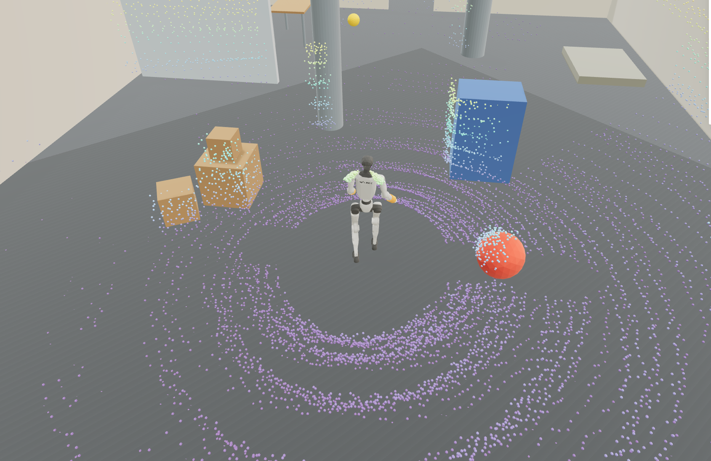
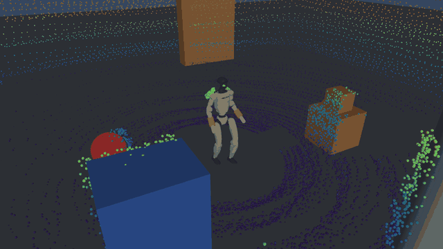
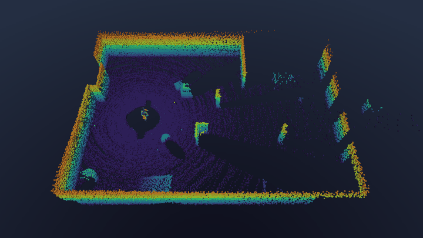
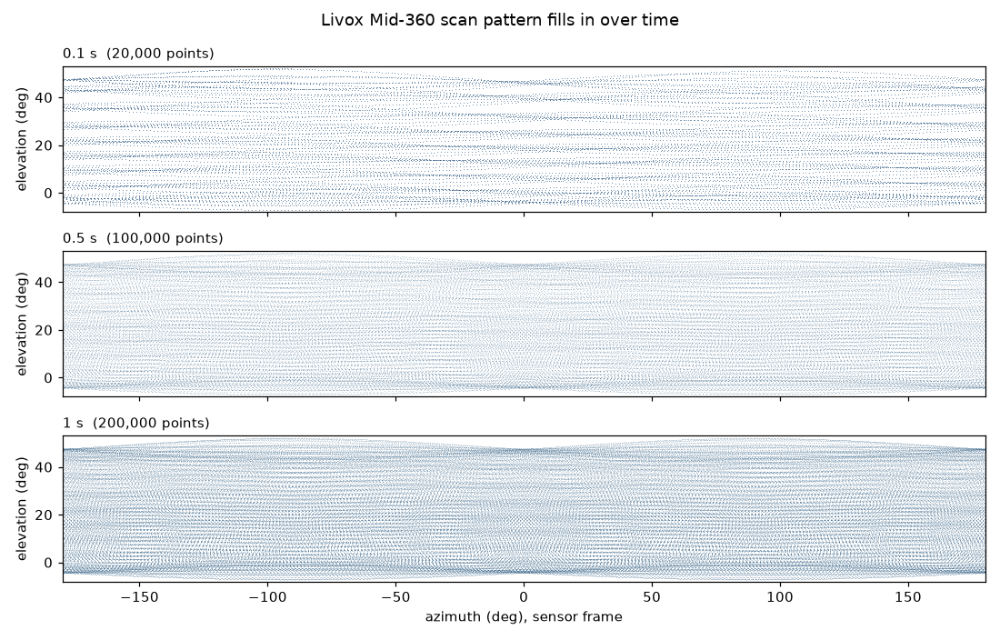
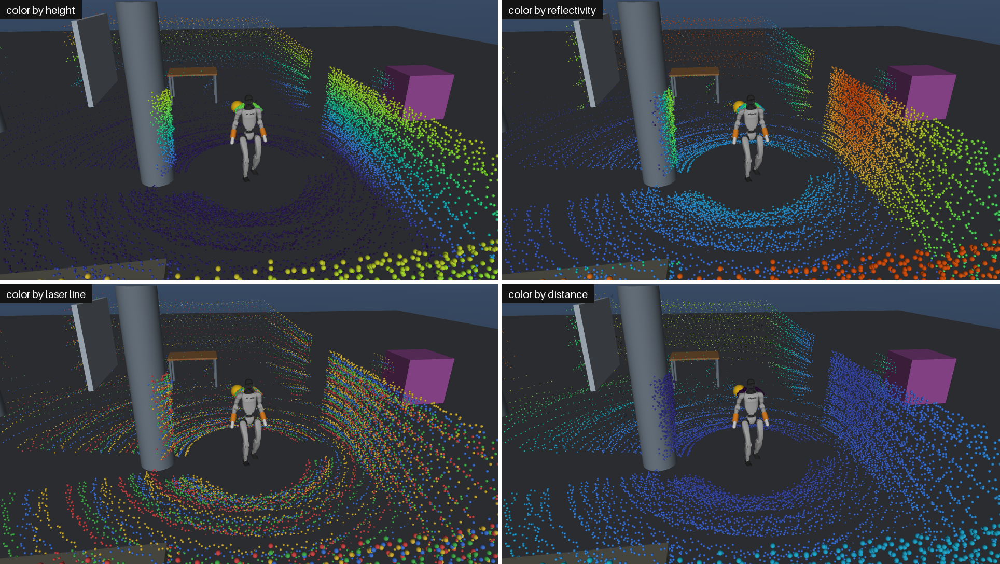
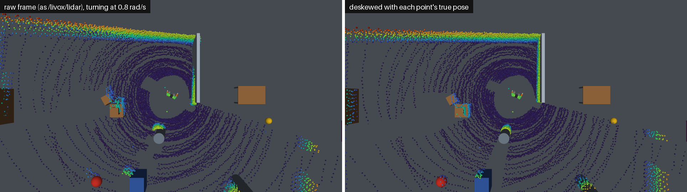
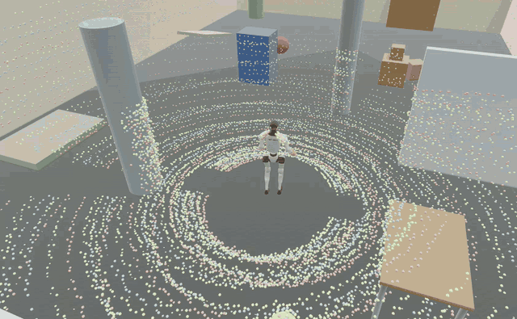
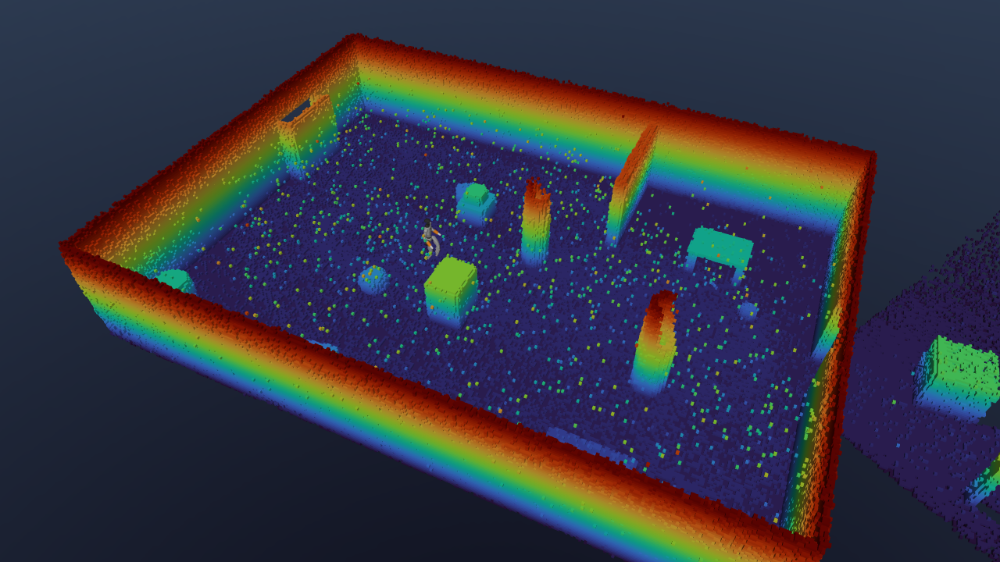

# Livox Mid-360 LiDAR for the Unitree G1 in mjlab

A simulated **Livox Mid-360** that behaves like the one in the Unitree G1's head,
for [mjlab](https://github.com/mujocolab/mjlab) (MuJoCo Warp, GPU, batched).
It uses Livox's real non-repetitive scan pattern, fires it at the real point
rate, cuts frames like the ROS driver, and applies the datasheet range limits,
noise and false alarms. It also includes the sensor's built-in IMU. Point
fields match `livox_ros_driver2`'s `CustomMsg`.



<p align="center">
  
  
</p>

## Contents

- [What is simulated](#what-is-simulated)
- [Install](#install)
- [Quick start: the demo](#quick-start-the-demo)
- [Integrate into your G1 in mjlab](#integrate-into-your-g1-in-mjlab)
- [Matching your real G1](#matching-your-real-g1)
- [API](#api)
- [Limitations](#limitations)
- [Repository layout](#repository-layout)
- [Credits and license](#credits-and-license)

## What is simulated

| | Real Mid-360 | This package |
|---|---|---|
| Scan pattern | Non-repetitive rosette, 4 lasers | Livox's recorded scan table, fired in its time order. `line` = point index mod 4 (the 4 lasers interleave in the table) |
| Point rate | 200,000 points/s (first return) | Same. Each `sense()` fires the next `200k × dt` rays from the pose at that moment, so a walking robot distorts a frame like on hardware |
| Frame rate | 10 Hz typical (driver `publish_freq`) | `Mid360Cfg.frame_rate`: 20,000 points per 10 Hz frame, `offset_time` in 5 µs steps |
| FOV | 360° × (−7° … 52°) | Same (from the table) |
| Blind zone | 0.1 m | Same |
| Max range | 40 m on 10 % reflectivity, 70 m on 80 % | Same. Reflectivity × cos(incidence) sets the range limit |
| Range precision (1σ) | ≤ 3 cm at 0.2 m, ≤ 2 cm at 10 m | Same, interpolated in between |
| Angular precision (1σ) | < 0.15° | 0.15° per axis |
| False alarm rate | < 0.01 % | 0.01 % of rays return a spurious point |
| Coordinates | int32 millimetres, no return = 0 | Same (1 mm quantization, zeros for no return) |
| Point fields | `reflectivity`, `tag`, `line`, `offset_time` | Same layout as `CustomMsg` |
| IMU | ICM-40609, 200 Hz, gyro rad/s, accel g, at (11.0, 23.29, −44.12) mm in the point cloud frame | Same, with the TDK noise densities 4.5 mdps/√Hz and 100 µg/√Hz |
| Mount on G1 | Head, `mid360_joint` in Unitree's URDF, upside down | Same pose (see [Matching your real G1](#matching-your-real-g1)) |

The pattern fills in over time, like the real sensor:



Every point carries the real fields:



A raw frame is captured while the robot moves, so turning bends it. Placing
each point with its own pose (which is what FAST-LIO's IMU deskew does)
straightens it:



## Install

You need Linux x86_64, an NVIDIA GPU with a CUDA 12.8 capable driver, Python
3.10 to 3.13, and [uv](https://docs.astral.sh/uv/).

```bash
git clone https://github.com/bethalageetachandraraju/livox-mid360-lidar-unitree-g1-mjlab.git
cd livox-mid360-lidar-unitree-g1-mjlab
uv sync
uv run pytest            # 7 tests, about 30 s
```

`uv sync` installs mjlab (pinned to the commit this was tested on),
[MuJoCo-LiDAR](https://github.com/TATP-233/MuJoCo-LiDAR) (for the Livox scan
tables), and CUDA PyTorch.

To use it inside an existing mjlab project, add the package to that
environment instead:

```bash
uv pip install -e /path/to/livox-mid360-lidar-unitree-g1-mjlab
```

## Quick start: the demo

A braced G1 (29-DoF, hands replaced by wrist braces and forearm extensions)
walks a tour through a 14 × 10 m furnished room with a door, driven by an
RSL-RL walk policy (`demo/checkpoints/g1_walk_rough_42998.pt`). Physics, rays
and the IMU run in mjlab at 1 × real time.

```bash
uv run python demo/lidar_sim.py                 # tour around the room
uv run python demo/lidar_sim.py --manual        # drive with sliders
uv run python demo/lidar_sim.py --frame-rate 20 --no-noise
```



The live tab, coloured by laser line ([full video](media/viewer_demo.mp4)).

Open two browser tabs:

| Tab | What you see | Controls |
|---|---|---|
| http://localhost:8080 | Robot, objects and the live Mid-360 frame. `raw` draws the frame at its start pose, like RViz shows `/livox/lidar`. `deskewed` places every point with its own true pose | Tour / Manual, vx vy wz sliders, Stop, Reset, Pause. Colour by height / distance / reflectivity / laser line. Noise on/off. Status shows frame stats and the IMU (g, rad/s) |
| http://localhost:8081 | LiDAR map: deskewed frames in 5 cm voxels (`--voxel`), robot path, current frame in white | Clear map, Save map (`.ply` to `maps/`), voxel size |



The map is registered with the true sensor pose, so it shows what an ideal
FAST-LIO would build. The isolated specks above the floor are the 0.01 % false
alarms adding up over the run, as on real maps. Hits within 0.5 m of the
sensor axis (the robot itself) are left out of the map but kept in the live
frame, like the raw driver output.

Options: `--port` (live tab; the map tab is `port + 1`), `--voxel`,
`--frame-rate`, `--no-noise`, `--manual`, `--checkpoint`, `--duration` (sim
seconds, then exit).

## Integrate into your G1 in mjlab

Three steps: put the sensor on the robot, add a ray sensor to the scene, then
feed it to the measurement model.

### 1. Add the Mid-360 to the robot

`add_g1_mid360(spec)` adds to `torso_link`:

- the point cloud frame site `mid360`;
- the IMU site `mid360_imu`;
- the MuJoCo sensors `mid360_gyro` and `mid360_accel`.

Wrap your robot's `spec_fn`:

```python
from livox_mid360_mjlab import add_g1_mid360

robot = cfg.scene.entities["robot"]  # e.g. from get_g1_robot_cfg()
base_spec_fn = robot.spec_fn


def spec_with_mid360():
  spec = base_spec_fn()
  add_g1_mid360(spec)
  return spec


robot.spec_fn = spec_with_mid360
```

For another robot or mount, use
`add_mid360(spec, body, pos, quat, name="mid360")` with the pose of the point
cloud frame in that body.

### 2. Add the ray sensor to the scene

The sensor fires the rays of `sense_dt` seconds on every `sim.sense()`. Use
the interval at which you call `sense()`:

```python
from mjlab.sensor import ObjRef
from livox_mid360_mjlab import G1_MID360_SITE, Mid360Cfg, mid360_raycast_cfg

mcfg = Mid360Cfg()  # frame_rate=10, noise=True, ...
lidar = mid360_raycast_cfg(
  "mid360",
  ObjRef(type="site", name=G1_MID360_SITE, entity="robot"),
  sense_dt=env_step_dt,  # e.g. 0.02 in mjlab RL tasks
  cfg=mcfg,
)
cfg.scene.sensors = (cfg.scene.sensors or ()) + (lidar,)
```

- **In an RL task** (`ManagerBasedRlEnv`), mjlab calls `sense()` once per env
  step. So `sense_dt = timestep × decimation`: 4000 rays every 20 ms at 50 Hz.
- **In your own loop**, call `sense()` after every physics step with
  `sense_dt = timestep`. You get 1000 rays every 5 ms, and motion distortion at
  5 ms resolution.

The parent body (head and torso) is excluded from the rays because the sensor
sits inside the head shell. By default the rays see geom groups 0 to 2, which
includes the G1's visual meshes, so shoulder and arm self-hits show up as on
the real robot. Pass `include_geom_groups` to change that.

### 3. Turn rays into Mid-360 frames and read the IMU

```python
from livox_mid360_mjlab import Mid360, Mid360Imu

mid360 = Mid360(env.scene["mid360"], env.sim.mj_model, env_step_dt, mcfg)
imu = Mid360Imu(env.sim.mj_model, f"robot/{G1_MID360_SITE}", mcfg)

t = 0.0
while True:
  env.step(actions)
  t += env_step_dt
  gyro, accel = imu.read(env.sim.data.sensordata)  # [B, 3] rad/s, [B, 3] g
  frame = mid360.update(t)  # None until a frame is complete
  if frame is not None:
    pts = frame.points[frame.valid]  # sensor frame, like /livox/lidar
```

Everything is batched over `num_envs` on the GPU. A full runnable version on
mjlab's stock G1 velocity task:

```bash
uv run python examples/velocity_env_with_mid360.py --num-envs 4 --steps 50
```

```
t  0.00s  frame (4, 20000, 3)  returns per env [16091, 16103, 16095, 16102]  accel env0 [ 0.24 -0.92 -2.02] g
t  0.10s  frame (4, 20000, 3)  returns per env [16204, 16175, 16136, 16150]  accel env0 [-0.16  0.01 -1.2 ] g
```

The IMU is sampled whenever you call `read()`. Call it every 5 ms physics step
to get the real 200 Hz rate.

### Using it for RL observations

For a policy you usually want something cheaper than full frames. The ray
sensor's own data (`env.scene["mid360"].data.hit_pos_w`, `.distances`) holds
the newest batch of Mid-360 rays every step, and works with mjlab observation
terms like any `RayCastSensor`. For noise and range limits that match the
hardware, build the observation from `Mid360.update()` output, for example a
height map from `frame.points_w`.

## Matching your real G1

**Mount.** The point cloud frame is Unitree's `mid360_joint` (from
`g1_29dof_rev_1_0.urdf`), rolled by π because the sensor is mounted upside
down:

| | Value |
|---|---|
| Parent body | `torso_link` |
| Position (m) | (0.0002835, 0.00003, 0.41618) |
| Orientation | pitch 0.0401 rad (2.3° nose down), then roll π |
| Quaternion (w, x, y, z) | (0, 0.99980, 0, −0.02007) |
| Resulting axes | x forward, z down. Sees from 7° above the horizon down to the floor about 1 m around the feet |

**Check the mount on your robot.** With the robot standing still, read
`/livox/imu`. Upside down, `linear_acceleration.z` is about **−1 g**; mounted
upright it would be +1 g. The sim reads −1 g. If your robot reads +1 g, change
`G1_MID360_QUAT` to the unflipped URDF pitch, (0.99980, 0, 0.02007, 0).

**FAST-LIO / IMU extrinsics.** The IMU sits at (11.0, 23.29, −44.12) mm in the
point cloud frame, with axes aligned. That is the standard Mid-360 FAST-LIO
setting:

```yaml
extrinsic_T: [ -0.011, -0.02329, 0.04412 ]
extrinsic_R: [ 1, 0, 0,  0, 1, 0,  0, 0, 1 ]
```

**Units and topics.** `Mid360Imu.read()` returns gyro in rad/s and accel in g,
which is what `livox_ros_driver2` publishes on `/livox/imu` (it doesn't
convert to m/s²). `Mid360Frame` maps one to one onto `CustomMsg` on
`/livox/lidar`:

| `CustomMsg` | `Mid360Frame` |
|---|---|
| `timebase` (ns) | `timebase` (s) × 1e9 |
| `point_num` | `points.shape[1]` (or `valid.sum()` to drop no-returns) |
| `points[i].offset_time` | `offset_time[i]` (ns) |
| `points[i].x, y, z` | `points[b, i]` (m, sensor frame, 1 mm steps) |
| `points[i].reflectivity` | `reflectivity[b, i]` |
| `points[i].tag` | `tag[b, i]` (0) |
| `points[i].line` | `line[i]` (0 to 3) |

On the G1 the head Mid-360 is commonly configured at `192.168.123.120`, read
with `livox_ros_driver2` using `xfer_format: 1` (CustomMsg) and
`publish_freq: 10.0`.
`Mid360Cfg(frame_rate=...)` mirrors `publish_freq`.

## API

| Name | What |
|---|---|
| `LivoxPatternCfg(model="mid360", samples=20000)` | Scan table from MuJoCo-LiDAR (`mid360`, `avia`, `HAP`, `horizon`, `mid40`, `mid70`, `tele`) |
| `LivoxRayCastSensorCfg` / `LivoxRayCastSensor` | mjlab `RayCastSensor` that steps through the table. Adds `local_directions` and `hit_geom_ids` |
| `mid360_raycast_cfg(name, frame, sense_dt, cfg)` | Ray sensor config with the right ray count for `sense_dt` |
| `Mid360Cfg` | Rates, limits and noise (datasheet defaults). `noise=False` gives ideal ranges |
| `Mid360(sensor, mj_model, sense_dt, cfg)` | `.update(t)` returns a `Mid360Frame` when a frame is complete |
| `Mid360Frame` | `timebase`, `offset_time`, `points`, `reflectivity`, `tag`, `line`, `valid`, plus `points_w` (deskewed, world) and `pos_w` / `quat_w` at `timebase` |
| `Mid360Imu(mj_model, name, cfg)` | `.read(sensordata)` returns (gyro rad/s, accel g) |
| `add_mid360(spec, body, pos, quat, name)` | Frame site + IMU site + gyro/accelerometer |
| `add_g1_mid360(spec)` | The G1 head mount (`G1_MID360_*` constants) |
| `geom_reflectivity(mj_model)` | Per-geom reflectivity used by the model |

## Limitations

- **Reflectivity** comes from each geom's colour (luminance, clipped to
  5–95 %), because MuJoCo has no infrared material data. The 0–150 byte scale
  for 0–100 % follows the older Livox convention; the Mid-360 documents don't
  state it.
- **Not modelled:** IMU bias and bias drift (white noise only), the
  rain/fog/dust and edge `tag` bits, retro-reflectors (byte 151–255),
  multipath, and beam divergence.
- **Head shell:** the head/torso body is excluded so rays can leave the sensor.
  The steepest downward rays can therefore pass through the shoulders where the
  real head would block them.
- **Time resolution:** rays within one `sense()` share a pose, so motion
  distortion is resolved to `sense_dt` (5 ms in the demo), not per point.
- **Robot used in the demo:** the demo robot is a braced G1 (no hands). For a
  stock G1, use `add_g1_mid360` with mjlab's G1 as shown above.

## Repository layout

```
src/livox_mid360_mjlab/
  pattern.py      Livox scan table + RayCastSensor subclass
  mid360.py       Mid-360 measurement model, frames, IMU, add_mid360
  g1.py           G1 head mount
demo/
  lidar_sim.py    Room, walking G1, two browser tabs (viser)
  g1_braced.py    Braced G1 29-DoF built from mjlab's G1 MJCF
  walk_policy.py  Numpy walk policy
  checkpoints/    Walk policy weights
examples/
  velocity_env_with_mid360.py   Mid-360 in mjlab's G1 velocity task
scripts/
  make_media.py   Regenerates the rendered images and GIFs in media/ (offscreen)
tests/            Pattern, mount, timing, noise, range, blind zone, IMU
```

To regenerate the rendered media (about 3 minutes, no browser needed; the
viewer screenshot and screencast were recorded from the browser):

```bash
uv run python scripts/make_media.py
```

## Credits and license

- Scan tables: [MuJoCo-LiDAR](https://github.com/TATP-233/MuJoCo-LiDAR) (MIT),
  installed as a dependency.
- Simulator: [mjlab](https://github.com/mujocolab/mjlab) (Apache-2.0) on
  [MuJoCo Warp](https://github.com/google-deepmind/mujoco_warp).
- Sensor numbers: [Livox Mid-360 specs](https://www.livoxtech.com/mid-360/specs),
  [Mid-360 Ethernet protocol](https://livox-wiki-en.readthedocs.io/en/latest/tutorials/new_product/mid360/livox_eth_protocol_mid360.html),
  [TDK ICM-40609-D](https://invensense.tdk.com/en-us/products/6-axis/icm-40609-d).
- G1 model and mount: Unitree `g1_29dof_rev_1_0.urdf` and mjlab's G1 MJCF.

Released under the [MIT License](LICENSE).
